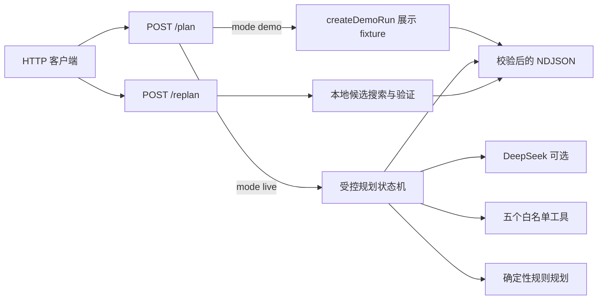
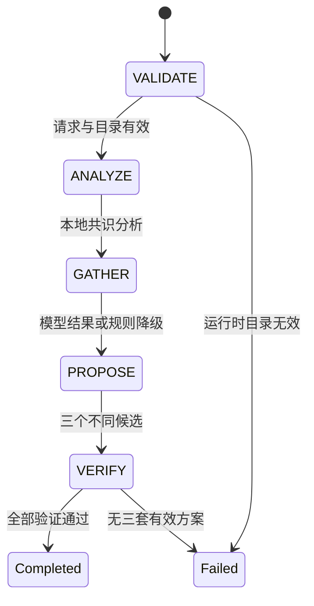

# Agent 架构

## 请求与事件

浏览器在共识页发起实时规划，工作台通过同源 HTTP 调用规划与重排接口。首页快速体验直接读取 `createDemoRun()`。两个端点先用 `src/contracts/agent.ts` 中的 Zod Schema 校验 HTTP 请求：无效 JSON 或请求字段会在进入状态机前收到 HTTP 400 JSON 错误，不产生事件。已进入状态机后的运行失败才以 `run.failed` 事件结束。成功响应为 `application/x-ndjson`，每行一个事件，最后恰好一个 `run.completed` 或 `run.failed`。`plan` 使用 `ReadableStream` 和可选事件 sink，在模型仍等待时发送 `run.started` 与早期进度；`runPlanningAgent` 同时保留数组返回接口。每条事件在原对象描述符、JSON 安全、Schema 和实际序列化行四层检查后入队。异常在尚未终止时补一个脱敏 `run.failed` 并关闭，已终止后不再发送。`replan` 仍返回有界的缓冲 NDJSON。

HTTP 先逐块读取并限制实际 UTF-8 请求体为 32 KiB（`413 REQUEST_TOO_LARGE`），再 JSON/静态字段校验，再检查上海今天至 +180 天的移动日期窗口。共享设定仅接受周末、3–12 小时和上海区域白名单；偏好字符串/数组有上限。实时 `plan` 最后在模型创建和所有外部工具调用之前检查模块级限流：可信 Netlify IP + `sessionId` 每十分钟五次、最多 5,000 个键，清除过期或最早记录。演示绕过额度。`429 RATE_LIMITED` 标记可重试；时钟与限流器均可注入。它只保护当前 warm instance，重启、不同实例和更换会话不共享额度；持久分布式强制执行不在本 MVP 范围。

## 初始规划

初始实时规划最多发起 **2 次模型请求**，最多执行 **6 次模型请求的工具调用**，且只接受 `get_weather`、`search_places`、`estimate_route`、`calculate_budget`、`validate_plan`。工具名与参数在服务端校验；第二次模型响应不能再触发工具执行。代码负责请求校验、地点目录、偏好共识、工具调用、候选数据规范化、路线与预算重算、硬约束验证，以及向客户端发出事件。模型只提议工具调用和候选行程，不能决定最终是否通过验证。每个候选的确定性验证独立于六次模型请求工具调用；事件中按路线、预算、验证工具汇总候选数量、范围及候选 ID 对应的违规/警告代码，包括失败模型候选和规则回退的验证尝试。摘要类型在 `src/contracts/evidence.ts`，生成时仅选择公开字段。

缺少 `DEEPSEEK_API_KEY`、模型出错、无效调用、工具失败或候选验证失败时，运行会发出 `run.degraded` 并尝试规则规划。`DEEPSEEK_MODEL` 未配置时默认使用 `deepseek-flash`。规则方案也必须通过同一验证；若无法形成三套有效行程，终止于 `run.failed`。未调用天气工具就没有天气证据。天气工具的查询范围由服务端从请求日期和时间生成，坐标固定在上海人民广场附近；Open-Meteo 失败或没有行程内的小时数据时尝试已配置的 QWeather，两者均不可用才返回 `WEATHER_UNAVAILABLE`，不会生成虚构天气。预报范围、真实来源和启用条件见[天气接口说明](WEATHER.md)。

初始成功结果的 `candidateIds` 恰好三个，且没有 `diff`。`mode: "demo"` 是固定展示事件，不执行实时规划。其部分 `placeId` 不在服务端地点目录中，不能作为重排输入。

## 局部重排

`POST /.netlify/functions/replan` 不调用 DeepSeek 或网络。请求包含完整原方案、两人的偏好、设定、`rejectedStopId`、`lockedStopIds`、原因和 `replanCount`。请求 Schema 只接受 `replanCount` 为 0 或 1，供可信客户端按会话约定执行最多两轮。Function 本身无状态，无法识别重复提交的 0 或 1；若要在服务端持久执行轮次限制，需要会话状态或速率存储，这超出当前无数据库 MVP 的范围。服务端从静态目录选择未出现在原方案中的替代地点，只调整被否决站点及必要时相邻、未锁定站点的时间；其余站点保持原样。锁定站点不能被否决，否则返回 `409 LOCKED_STOP_CONFLICT`。找不到满足时间、路线、预算和其他硬约束的替代方案时返回 `422 NO_VALID_REPLAN`。

`reasonCode` 可指定 `CHANGE_PLACE`、`TOO_CROWDED`、`TOO_EXPENSIVE`、`TOO_MUCH_WALKING`、`PREFER_INDOOR`、`PREFER_OUTDOOR`、`CHANGE_ACTIVITY`。省略时只解析固定中英文关键词：排队/拥挤、贵/预算、步行/太远、室内/雨、户外、另一个/同类，以及九个兴趣及其英文别名。未匹配时返回 `400 UNSUPPORTED_REPLAN_REASON`。类别反馈同时执行明确的正向/负向兴趣；拥挤排除排队/拥挤标签，费用与距离分别优先排序，室内外筛选替换地点。修改后重建标题、摘要、分数和解释，不继承旧解释。

成功重排依次发出 `REPLAN`、本地路线/预算/验证工具摘要、`VERIFY`、一个 `plan.proposed`，然后以只含一个元素的 `candidateIds` 和必需的 `diff` 结束。`diff` 列出替换站点 ID 与保留站点 ID。

## 数据可信度

`data/places.shanghai.json` 是静态地点目录，包含来源网址、营业时间、价格区间和 `lastVerifiedAt`。天气工具在生产注册表之间复用模块级缓存，Open-Meteo 最多缓存 500 个日期/坐标范围，QWeather 最多缓存 500 个坐标/行程区间，TTL 均为 30 分钟；同一范围的并发请求共享一次获取，失败不缓存。工具、获取函数及测试时钟仍可注入。

验证器对距计划日期超过 90 天的来源数据生成 `STALE_PLACE_DATA` 警告，但这些字段并非实时核实。路线使用坐标直线距离及固定步行/交通速度估算，预算使用目录价格上限、每段交通补贴和缓冲率计算；都不代表实时路况、班次、票价或营业状态。展示 fixture 中的天气与数值也仅用于演示。

无方案的 `run.failed.constraintCodes` 只公开 `BUDGET_EXCEEDED`、`OUTSIDE_TIME_RANGE`、`PLACE_CLOSED`、`WALKING_LIMIT_EXCEEDED`、`AVOID_TAG_MATCHED`、`DUPLICATE_PLACE`、`LOCKED_STOP_CHANGED`、`INSUFFICIENT_CANDIDATES`。工具摘要不包含原始偏好、地址、来源 URL、API 错误或隐藏推理；自定义避让仍参与硬约束，但只回显界面白名单中的通用避让名称。
