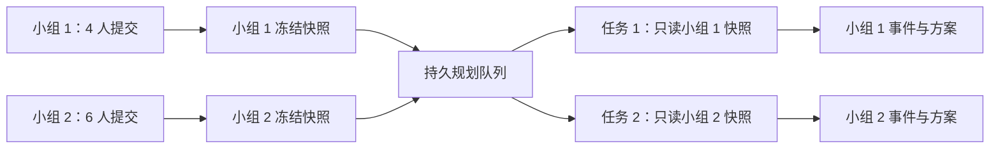

# 多小组邀请与 2–6 人独立填写设计

状态：本地实现完成；Task1–4审查及修复通过，Task5真实Node22.11全套492项测试、构建、独立Chromium2/6人及双组/队列验证、隔离PM2发布回滚和备份恢复干跑已完成。Task5及全分支独立审查、生产部署、真实DeepSeek/天气双组联调和公网HTTPS验收仍待控制器完成。证据详见本地Task5报告与acceptance记录，未宣称已上线。

## 1. 已确认的需求

- 每个出游小组有 2–6 人，创建时先确定人数。
- 创建者通过邀请链接邀请其他人，成员在各自设备上独立填写。
- 全员提交完成后，服务端统一将本组填写内容交给 Agent。
- 多个小组可以同时填写、等待规划、查看各自结果，互不覆盖。
- 修复同一浏览器多次使用时出现旧偏好残留的问题。
- 延续现有 DeepSeek、真实天气工具、三套方案、约束校验和局部重排能力。

## 2. 实现方案比较与推荐

| 方案 | 适用情况 | 对当前项目的影响 |
| --- | --- | --- |
| 阿里云现有 Node 服务 + SQLite + 持久任务队列（推荐） | 单台服务器上的个人项目、小组邀请与演示 | 无需购买数据库服务；增加服务端持久存储、身份校验和任务处理 |
| 托管 PostgreSQL 与身份服务 | 未来多实例部署或完整账户体系 | 依赖第三方服务、网络和额度；本轮没有必要引入 |
| 自建 MySQL/PostgreSQL 与 Redis | 已有运维体系或更大流量 | 增加常驻服务和运维工作，对当前约 2 GB 内存的服务器较重 |

采用第一种方案。SQLite 用于短事务；等待 DeepSeek、天气等网络请求时不持有数据库事务。Agent 并发执行数初始设为 2，其余任务按入队时间等待。这个数字是可调整的运行参数，不是已经完成的容量测试结论。

多个小组同时使用不等于无限并发调用大模型。首轮用隔离与队列保证正确性，实际吞吐量、内存和响应时间在压测与真实联调中验证。

## 3. 用户流程

1. 创建者填写小组名称、人数、日期、时间、出发区域与全员总预算；创建者计入总人数。
2. 系统创建独立小组与创建者的成员身份，进入小组大厅。
3. 创建者复制小组邀请链接；本轮无需注册账号、手机号或邮箱。
4. 其他成员打开邀请链接，填写昵称并加入空余席位；昵称允许相同，身份由成员标识决定。
5. 每位成员进入自己的偏好表单。首次填写时兴趣、饮食、避让和愿望为空，不继承其他人或其他小组的答案；节奏、步行等单选项有明确默认值。
6. 提交后返回大厅，显示“已提交 3/4 人”等进度；已提交成员在规划入队前可修改自己的答案。
7. 最后一位成员提交后，服务端在同一个事务中核实人数和提交状态，冻结输入快照并创建唯一规划任务。
8. 所有成员看到排队或 Agent 进度。即使创建者已关闭页面，服务端仍继续处理。
9. 规划完成后，所有成员查看本组同一版三套候选；创建者操作方案锁定、局部调整与最终确认，其他成员查看同步结果。

本轮不增加投票、聊天、自动发送通知或成员逐个确认最终方案。

## 4. 页面与交互

### 创建页

- 人数范围为 2–6，默认 2 人；全员总预算默认 `人数 × 150 元`，允许修改。
- 总预算范围为 100 元到 `人数 × 2,000 元`，旁边显示人均参考金额。
- 创建计划生成新小组，已有小组保留在“我的计划”中；不会复用已有偏好。
- 公共条件在其他成员加入后锁定，避免某人按旧条件填写。更改人数或公共条件时创建新一轮并明确提示。

### 小组大厅

- 显示小组名、公共条件、目标人数、已加入人数、已提交人数。
- 成员卡片只显示昵称及“待填写／已提交”，不显示个人原始答案。
- 创建者可复制邀请、重新生成邀请链接，以及在开始规划前移除非创建者席位；移除同时撤销该成员的访问授权，空位可重新邀请。
- 本人的入口为“填写我的偏好”或“修改我的偏好”，不由前端自由传入另一个成员的身份。
- 已满、已开始、已过期和无效邀请各有明确反馈；已加入成员重复打开邀请时恢复自己的身份，不自动多占席位。
- 通过每 3 秒一次的状态轮询更新大厅；标签页隐藏时降频，恢复可见时立即同步。首轮无需 WebSocket。

### 独立偏好页

- 显示“正在为昵称填写”和本组公共条件。
- 草稿只按 `groupId + memberId + revision` 保存，切换小组或成员不会复用上一个表单组件状态。
- 原始偏好只允许本人读取和修改，服务端从登录凭据确定成员身份。
- 对同一成员多标签页编辑使用版本号检测冲突；旧版本保存失败时提示先同步，不静默覆盖。
- 同一设备为另一位填写必须显式点击“交给下一位”，创建独立成员身份和空白表单；同设备交接不承诺对设备持有人实现加密保密。

### 共识、Agent 与结果页

- 全员完成后显示共同兴趣、各兴趣支持人数与需要协调的差异。
- 排队显示“已收齐，正在等待规划”；执行时显示本任务进度与实际工具来源。
- 刷新或换设备恢复身份后，读取服务端保存的事件与结果，不重新发起同一轮模型调用。
- 预算、人数文案、行程导出与只读分享快照使用本组实际人数。
- “我的计划”可显示本浏览器有授权的小组；用户需要恢复链接才能在新设备找回身份，不提供按昵称找回。

## 5. 小组、成员与授权隔离

小组 ID、成员 ID、规划任务 ID 分开管理。知道小组 ID 不等于拥有访问权限。

- 小组邀请使用高熵随机凭据，持有者可在小组收集阶段加入空位；它不授予读取他人偏好或修改公共条件的权限。
- 邀请凭据放在链接片段中，网页读取后通过请求正文提交；不把凭据拼到日志中的 URL 查询参数里。
- 服务端颁发随机浏览器会话凭据，使用 Secure、HttpOnly、SameSite Cookie；数据库保存凭据摘要与对应授权。
- 一个浏览器可持有多个小组的授权。主动交接同一设备时，可持有该组多个成员授权，但 UI 必须明确当前填写身份。
- 创建者身份、本人成员身份、普通组员权限分别检查；创建者不能通过管理接口直接读取其他人的完整原始偏好。
- 提供个人恢复链接和创建者管理恢复链接，分别授予对应权限，不能混同小组邀请链接；恢复链接按持有者授权，不支持丢失后的人工昵称找回。
- 所有组查询、成员提交、任务事件、重排和最终确认均校验小组归属；只靠请求体中的 groupId/memberId 不足以授权。
- 写接口执行同源检查、请求体大小限制与基于浏览器/IP 的速率限制。Cookie 会话凭据、邀请、恢复链接和偏好正文不得进入普通日志。

数据库记录保留到创建后 30 天；邀请在创建 7 天后或进入规划阶段时失效。界面显示过期时间，过期小组不再接受写入，后台定期清理过期记录。隐私说明明确该期限及原始偏好会在服务端保存并用于模型规划。

## 6. 数据模型

| 实体 | 关键字段与约束 |
| --- | --- |
| groups | groupId、名称、ownerId、targetCount、setup、state、revision、createdAt、expiresAt、inviteTokenHash |
| members | memberId、groupId、昵称、角色、提交状态；每组有效成员数量不能超过 targetCount |
| preferences | groupId、memberId、revision、结构化偏好、编辑版本、submittedAt；同成员同轮唯一 |
| access_grants | browserSessionHash、groupId、memberId、权限、恢复凭据摘要、失效时间 |
| planning_snapshots | groupId、revision、全员条件快照、摘要；同组同轮唯一且冻结后不可修改 |
| jobs | jobId、groupId、revision、attempt、状态、租约、错误码、创建时间；同组同轮同次尝试唯一 |
| events/results | groupId、jobId、事件序号、事件或候选结果；读取必须匹配授权小组与任务 |

外键和事务约束用于防止跨组写入、超员和重复入队。SQL 使用参数绑定。网络请求不能放进 SQLite 的写事务中。

## 7. 全员提交与多组并发

- 最后两人同时提交时，用事务与唯一约束保证同轮只创建一个逻辑任务；提交重试使用幂等键。
- 每个任务单独构造请求、模型适配器、工具结果和事件接收器，不共享对话历史。
- 同一时间先允许 2 个 Agent 任务执行，其他小组排队；填写与读取状态不占 Agent 执行名额。
- 天气可复用按坐标与日期范围建立的公共缓存，成员偏好、模型对话和结果不进入跨组缓存。
- 队列和快照持久化；服务重启后继续处理尚未开始的任务。
- 中断的执行任务先标记为可重试失败，不盲目自动重复付费请求。创建者显式重试新 attempt；可能已经发出的上游请求无法保证只计费一次。
- 使用任务租约与写入版本，旧尝试的迟到结果不能覆盖新尝试。
- 客户端断开、刷新或反复进入工作台都只恢复任务，不重复触发规划。
- 同组规划入队后冻结成员和偏好；需要更改时由创建者开启新一轮，全员重新确认后再入队。

## 8. 多人 Agent 与约束

输入从固定 `preferences.a/b` 改为 2–6 位稳定成员 ID 的列表。人数取服务器验证后的成员快照长度，不信任客户端独立传入的数量。

- 预算是全员合计；场馆成本按价格上限乘实际人数，交通补贴按每人每段 4 元，另加 10% 缓冲。
- 步行上限取全员最严格值；任何人的明确避让都参与硬约束，模型不能用多数表决覆盖个人禁忌。
- 全员共同兴趣与部分成员兴趣分开统计；没有全员交集时按覆盖人数、个人偏好排序及距离/预算组合候选，避免只照顾创建者。
- 对每份候选展示覆盖了多少人的兴趣，无法满足全部软偏好时如实说明。
- DeepSeek 读取该组冻结的完整偏好列表；提示、工具校验、预算、规则规划器、重排和最终验证全部覆盖同一份成员列表。
- 继续要求三套不同地点组合。约束太严而没有三套合法方案时，返回明确失败与放宽建议，不虚构方案。
- 每次原始偏好进入大模型前采用成员匿名 ID，昵称不作为规划所需字段发送。
- 模型方案失败而使用规则规划时必须如实展示来源与降级，不用隐藏降级事件冒充模型方案通过。

## 9. 接口边界

推荐服务端接口采用 `/api/groups` 前缀，内部复用现有 Agent 核心，而不是让浏览器为整个组上传任意成员答案。

| 操作 | 服务端行为 |
| --- | --- |
| 创建小组 | 创建公共条件、创建者成员与授权，返回小组大厅 |
| 通过邀请加入 | 校验邀请、事务内检查人数，创建或恢复本人身份 |
| 读取小组状态 | 返回公共条件、昵称/提交进度和当前任务，排除其他人的原始偏好 |
| 本人偏好保存/提交 | 校验本人授权、版本及收集状态；全员提交时原子冻结并入队 |
| 读取任务事件/结果 | 按 groupId/jobId/事件序号读取，断线续读且不新建任务 |
| 重试、重排、确认 | 创建者授权；服务端读取本组原快照和已有方案，避免客户端篡改人数、他人偏好或预算 |
| 重新开放收集 | 结束当前轮，增加 revision 并让全员重新确认；不把新条件写进旧任务 |

旧的双人本地缓存不能自动成为一个有云端授权的小组；升级时提供“创建新小组”入口，不把旧 B 的答案当作新成员答案。保留已有只读分享的解析能力。生产实时入口切换到有小组授权的新流程，防止旧的无身份接口绕过组内条件校验；演示保持可单独体验。

## 10. 存储与部署

- 数据文件位于 `/home/admin/apps/weekend-merge/data-runtime/groups.sqlite`，不放进每次替换的 `.deploy/releases` 目录。
- SQLite 数据、WAL、备份及本地恢复凭据加入忽略规则，不能提交 GitHub，也不能被静态服务器访问。
- 使用 Node 内置 `node:sqlite`，不要求服务器编译额外原生 npm 依赖。兼容现有 Node 22.11 时通过专门的服务器启动参数启用 `--experimental-sqlite`；CI 必须覆盖实际生产启动方式，并避免将该参数通过全局 NODE_OPTIONS 传递给无关程序。
- 部署环境增加稳定数据库路径、任务并发上限；现有 DeepSeek/QWeather 配置继续保留。
- 数据迁移有版本记录，部署前通过 SQLite 在线备份生成一致快照；不直接复制正在写入的单个数据库文件作为完整备份。
- 首次迁移采用向后兼容的新增表结构；回滚应用不会删除数据库。涉及不兼容迁移时必须单独提供回滚路径，不能沿用只切换代码即可回滚的承诺。
- GitHub CI 执行前后端测试、生产构建、临时数据库迁移、重启恢复和 PM2 部署检查。小组功能只部署到现有持久磁盘服务器；Netlify 无持久磁盘的 Function 不承诺支持 SQLite 小组服务。

## 11. 验收

1. 分别创建 2 人组与 6 人组，用独立浏览器上下文加入并填写；任意一个未提交时不得启动 Agent。
2. 同一组最后两人并发提交、网络重试、重复点击，只冻结一个快照、创建一个逻辑任务。
3. 至少两个小组同时完成并规划；输入、事件、方案、重排记录和完成状态互不串组。
4. 使用小组 1 凭据读写小组 2，以及使用成员 A 凭据改成员 B 答案，全部拒绝。
5. 满员邀请、过期邀请、撤销邀请、成员被移除、恢复链接分别有正确反馈。
6. 同浏览器新建计划、多个标签页、切换小组、显式设备交接和刷新后，不继承其他组或其他成员偏好。
7. 6 人预算按 6 人重算，最严格步行/任意成员避让均生效；初始规划与重排使用相同成员快照。
8. 任务排队时重启服务可以恢复；执行中断不会被页面刷新无限重复提交或付费。
9. 重试的新任务结果不会被旧任务覆盖，更新偏好不会修改已开始任务的输入。
10. 重启与 CI/CD 发布后数据仍存在；备份可恢复；浏览器响应和普通日志均无 API Key、其他成员偏好或完整授权凭据。
11. 用受控模型做多组并发回归后，再进行两组真实 DeepSeek/天气联调，确认小组绑定正确；记录实际耗时和内存。
12. 保留双人展示示例与旧分享快照，面向用户的说明准确区分真实天气、静态地点目录和路线估算。

## 12. 建议实施顺序

1. 小组/成员协议、SQLite 持久存储、授权、邀请和独立填写；先验证隔离与旧偏好问题。
2. 多人成本/共识/约束适配、全员提交快照、任务队列和断线恢复。
3. 小组大厅、各自填写、全员等待、共识/结果页面及本组创建者重排。
4. 部署数据路径与迁移备份、并发与权限回归、真实联调、文档和 GitHub 展示。

以上内容是已确认的实现约定，不能作为功能已经上线的说明。
